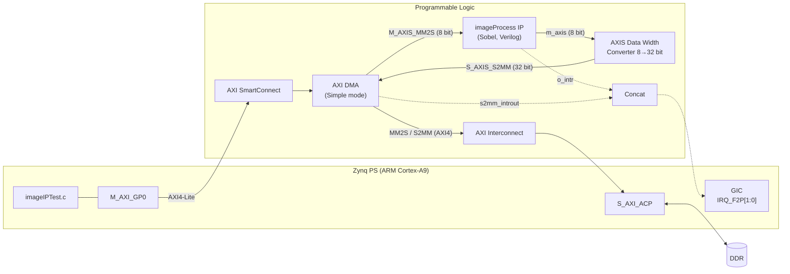
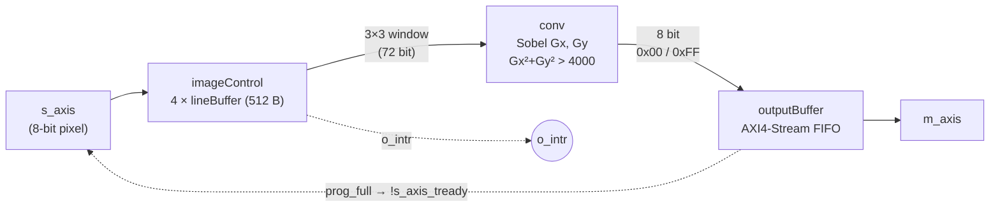

<a id="top"></a>

# Sobel Filter on Zynq-7000 (PS + PL)


---

## Overview

This repository contains a hardware-accelerated image processing system for the Xilinx Zynq-7000 architecture (ARM Cortex-A9 + FPGA), implemented on the **PYNQ-Z2** board (`xc7z020clg400-1`).

The Sobel edge-detection filter is a **custom RTL IP written in Verilog** (`imageProcess`). It runs as a streaming accelerator in the Programmable Logic (PL) and exchanges data with the Processing System (PS) DDR memory through an **AXI DMA** over **AXI4-Stream**. Pixel lines are fed to the IP **on demand, driven by interrupts**: the IP raises `o_intr` every time it finishes an output line, and the software answers by sending the next input line. There is no video output stage. The processed frame stays in DDR and is sent to the host PC over UART.

**Acknowledgments**

This repository follows the video series **Image Processing on Zynq (FPGAs)** by **Vipin Kizheppatt**.

---

## Index

- [Results](#results)
- [System Architecture](#system-architecture)
  - [Block Design](#block-design)
  - [Inside the imageProcess IP](#inside-the-imageprocess-ip)
- [Theoretical Background](#theoretical-background)
  - [Image Processing](#image-processing)
  - [Kernels and Convolution](#kernels-and-convolution)
  - [Sobel Operator](#sobel-operator)
  - [Sizing the Line Buffers](#sizing-the-line-buffers)
- [Implementation Guide](#implementation-guide)
- [Development Tools](#development-tools)
- [Reference Documentation (AMD/Xilinx)](#reference-documentation-amdxilinx)
- [Repository Structure](#repository-structure)
- [Project Status and Known Issues](#project-status-and-known-issues)
- [Project Recommendations](#project-recommendations)
- [License](#license)
- [Additional Notes](#additional-notes)
- [References](#references)

---

## Results

The test image is a 512 × 512 grayscale picture (`images/grayscale_landscape.pgm`) made from a image from [Pixabay](https://pixabay.com/pt/vectors/paisagem-pintada-casa-frango-flores-10246533/).

| Input (original) | Sobel filter output (behavioral simulation) |
|:---:|:---:|
|  |  |
| Color source image, converted to grayscale PGM | Binary edge map: `Gx² + Gy² > 4000` → white |

The filter compares the squared gradient magnitude with a fixed threshold, so each output pixel is either an edge (`0xFF`, white) or background (`0x00`, black).

The RTL image was produced by the testbench in the Vivado behavioral simulation (output file `sobel_filter_image.pgm`) and converted to PNG, because GitHub does not render PGM files.

---

## System Architecture

The Zynq **PS** configures the **AXI DMA** through its AXI4-Lite registers. The DMA moves pixels between DDR and the **imageProcess IP** over AXI4-Stream. Two interrupt lines go back to the PS: one from the IP (an output line is finished) and one from the DMA (the whole output frame has been written to DDR).



**Processing sequence** (implemented in [`sw/imageIPTest.c`](sw/imageIPTest.c)):

1. The PS starts an **S2MM** transfer of 512 × 512 bytes. The output is written back **into the same buffer** (`imageData[]`) that holds the input image.
2. The PS starts an **MM2S** transfer of the first **4 lines** (4 × 512 bytes) to fill the IP's line buffers.
3. Each time the IP finishes one output line, it pulses **`o_intr`** (`IRQ_F2P[0]`, interrupt ID 61). The ISR `imageProcISR()` waits for MM2S to be idle and sends the **next single line**.
4. After the last image line, the ISR sends **2 extra lines of zeros**, stored at the end of `imageData.h` (514 lines in total), so that the final output lines are pushed out of the pipeline.
5. When the DMA has written the whole frame to DDR, it raises **`s2mm_introut`** (`IRQ_F2P[1]`, interrupt ID 62). The ISR `dmaReceiveISR()` sets `done = 1`.
6. The main loop sends the 262,144 processed bytes through **UART0 at 115200 baud**.

### Block Design

<p align="center">
  <br>
  <em>Vivado block design <code>imageProcessingSystem</code>: Zynq PS, AXI DMA, imageProcess IP, data width converter, interrupt concat and System ILA</em>
</p>

| Block | Role |
| ----- | ---- |
| `processing_system7_0` | ARM PS. `M_AXI_GP0` (control), `S_AXI_ACP` (DMA access to DDR), `IRQ_F2P[1:0]` (fabric interrupts), `FCLK_CLK0` = 100 MHz |
| `axi_smc` | AXI SmartConnect: PS `M_AXI_GP0` → DMA `S_AXI_LITE` (DMA registers at `0x4040_0000`) |
| `axi_dma_0` | AXI DMA in Simple mode (no Scatter-Gather). MM2S stream 8 bit, S2MM stream 32 bit, buffer length register 23 bit |
| `axi_mem_intercon` | AXI Interconnect: DMA `M_AXI_MM2S` + `M_AXI_S2MM` → PS `S_AXI_ACP` (DDR, 512 MB) |
| `imageProcess_0` | Custom Sobel IP (Verilog), `user.org:user:imageProcess:1.0`, packaged into `hw/ip_repo/` with `tools/package_ip.tcl` |
| `axis_dwidth_converter_0` | Packs the IP's 8-bit output stream into 32-bit words for the DMA S2MM channel |
| `ilconcat_0` | Joins `o_intr` (In0) and `s2mm_introut` (In1) into `IRQ_F2P[1:0]` |
| `system_ila_0` | Debug: watches both AXI4-Stream links and `o_intr` |
| `rst_ps7_0_100M` | Processor System Reset for the 100 MHz domain |

### Inside the imageProcess IP



| Module | File | Description |
| ------ | ---- | ----------- |
| `lineBuffer` | [`hw/hdl/lineBuffer.v`](hw/hdl/lineBuffer.v) | Stores one 512-pixel line and outputs 3 consecutive pixels (24 bits) per read. |
| `imageControl` | [`hw/hdl/imageControl.v`](hw/hdl/imageControl.v) | Rotates 4 line buffers in a circular scheme: one is written while the other 3 are read. Builds the 3×3 window (72 bits) and pulses `o_intr` after each output line. |
| `conv` | [`hw/hdl/conv.v`](hw/hdl/conv.v) | Sobel operator in a 4-stage pipeline: multiply, sum (Gx, Gy), square, threshold (`Gx² + Gy² > 4000` → `0xFF`, else `0x00`). |
| `outputBuffer` | Xilinx FIFO Generator IP (`hw/ip_repo/src/outputBuffer/`) | AXI4-Stream FIFO, 8 bit, depth 16, programmable full at 8. `prog_full` drives `s_axis_tready` low (backpressure). |
| `imageProcessTop` | [`hw/hdl/imageProcessTop.v`](hw/hdl/imageProcessTop.v) | Top level packaged as the `imageProcess` IP (`s_axis`, `m_axis`, `o_intr`). |

---

## Theoretical Background

### Image Processing

Image processing is the set of techniques used to analyze, enhance, or transform digital images by manipulating their pixel values.

A grayscale digital image can be represented as a 2D function `I(x, y)`, where `x` and `y` are pixel coordinates and `I` is the intensity value at that point (commonly 0–255 for 8-bit images). Most classic processing operations, such as smoothing, sharpening, and edge detection, are local operations: the output at `(x, y)` depends only on a small neighborhood of input pixels around `(x, y)`, not the whole image.

### Kernels and Convolution

A kernel (*also called a convolution matrix or mask*) is a small, fixed-size weight matrix, typically 3×3 or 5×5, that is slid across an image to produce a new pixel value at every position. The mechanism is always the same convolution described below; only the numeric weights inside the kernel change, and those weights decide whether the effect is a blur, a sharpened image, an embossed relief, or a set of detected edges.

The 2D discrete convolution of an image `I` with a kernel `K` of size `(2a+1) × (2b+1)` is:

$$
G(x, y) = \sum_{i=-a}^{a} \sum_{j=-b}^{b} K(i, j) \cdot I(x - i, \; y - j)
$$

In practice: slide the kernel over the image, multiply each kernel weight by the pixel underneath it, and sum all the products to get the output pixel. Strict convolution flips the kernel horizontally and vertically first; when the kernel is symmetric (as with blur kernels) the flip has no visible effect, and skipping it turns the operation into *cross-correlation*, which is what most edge-detection implementations, including this one, actually compute.

The same hardware pipeline also works as a **3×3 mean (blur) filter** by setting all nine coefficients to 1 and dividing the sum by 9. That variant is kept in [`hw/hdl/conv-simulacao.v`](hw/hdl/conv-simulacao.v), and [`tools/blur_filter.m`](tools/blur_filter.m) is its MATLAB reference.

### Sobel Operator

The **Sobel filter** approximates the intensity **gradient** of the image at each pixel using two fixed 3×3 kernels, one for each direction. As implemented in [`conv.v`](hw/hdl/conv.v):

```
         +1  0  -1             +1 +2 +1
   Gx =  +2  0  -2       Gy =   0  0  0
         +1  0  -1             -1 -2 -1
```

Applying each kernel to the 3×3 window `A` gives the two gradient components:

$$
G_x = K_x * A
\qquad
G_y = K_y * A
$$

and the **gradient magnitude**:

$$
|G| = \sqrt{G_x^2 + G_y^2}
$$

`|G|` is large where the intensity changes sharply, which happens at object boundaries. (The sign convention of the kernels above is the opposite of some textbooks; it does not matter here because both components are squared.)

**Hardware simplification.** A square root is expensive in logic, so `conv.v` never computes it. It compares the **squared** magnitude with a constant instead:

$$
G_x^2 + G_y^2 > 4000 \iff |G| > \sqrt{4000} \approx 63
$$

Pixels above the threshold become `0xFF` (white, edge); all others become `0x00` (black). Raising the threshold keeps only the strongest edges; lowering it reveals weaker edges and more noise.

**Bit widths.** Each product fits in 16 signed bits (`|2 × 255| = 510`), each sum in 16 bits (`|4 × 255| = 1020`), each square in 21 bits (`1020² = 1,040,400 < 2²¹`) and the sum of squares in 22 bits (`2,080,800 < 2²²`).

### Sizing the Line Buffers

The 3×3 window needs the row above, the current row and the row below, so a streaming implementation does **not** store the whole frame, only a few lines.

For a `512 × 512` **8-bit grayscale** image (1 byte per pixel):

| Quantity   | Calculation   | Memory                 |
| ---------- | ------------- | ---------------------- |
| 1 line     | 512 × 1       | 512 bytes              |
| 3 lines    | 512 × 3       | 1,536 bytes = 1.5 KB   |
| 4 lines (used in `imageControl`) | 512 × 4 | 2,048 bytes = 2 KB |
| Full frame | 512 × 512 × 1 | 262,144 bytes = 256 KB |

`imageControl` uses **4** line buffers rather than 3, so that a new line can be written into the fourth buffer while the other three are read to build the window:

```
                 write ─► LB3 (next line arriving from the DMA)
Image (512x512)
                 read  ─► LB0 ┐
                 read  ─► LB1 ├─► 3×3 window (72 bit) ─► conv (Gx, Gy, Gx²+Gy²) ─► 0x00 / 0xFF
                 read  ─► LB2 ┘
       (the roles rotate after every 512-pixel line)
```

Reading starts once at least 1,536 pixels (3 full lines) are stored. Keeping only 2 KB of line memory instead of the 256 KB frame is what lets the filter work on a stream at one pixel per clock.

---

## Implementation Guide

The step-by-step guide is in the document below.

| Part | Document | Main Topics |
|:----:| -------- | ----------- |
| 1 | [implementation_guide_sobel_filter.md](docs/implementation_guide_sobel_filter.md) | AXI basics, Verilog modules, behavioral simulation, IP packaging, Block Design (DMA, ACP, interrupts), Vitis bare-metal application, UART capture, troubleshooting |

---

## Development Tools

| Tool    | Version  | Description |
| ------- |:--------:| ----------- |
| Vivado  | 2025.2.1 | RTL design, behavioral simulation, IP packaging, block design, synthesis, implementation and bitstream. |
| Vitis   | 2025.2.1 | Bare-metal software for the ARM Cortex-A9 (standalone, System Device Tree flow). |
| Python  | 3.12.3   | `tools/convert_pgm_to_c.py`: converts a PGM image into a C array (optional; the current flow generates `imageData.h` in the testbench). |
| MATLAB  | —        | `tools/blur_filter.m`: software reference for the blur variant. |
| GIMP    | —        | Converting and resizing test images to 512 × 512 binary PGM. |
| Board   | PYNQ-Z2  | Target hardware (`xc7z020clg400-1`). |

---

## Reference Documentation (AMD/Xilinx)

> Search using the document code — e.g., `"PG021 site:docs.amd.com"`.

| Document | Title | Main Topics |
| -------- | ----- | ----------- |
| PG021  | AXI DMA Product Guide | AXI DMA architecture, register map, Simple Mode vs Scatter-Gather, interrupts. |
| PG085  | AXI4-Stream Infrastructure IP Suite | AXI4-Stream Data Width Converter. |
| PG057  | FIFO Generator Product Guide | AXI4-Stream FIFO, programmable full flag. |
| UG585  | Zynq-7000 Technical Reference Manual | PS architecture, GP/HP/ACP ports, GIC and `IRQ_F2P` interrupt IDs, DDR controller. |
| UG1037 | AXI Reference Guide | AXI4, AXI4-Lite and AXI4-Stream protocols. |
| UG994  | Vivado Design Suite User Guide: Designing IP Subsystems | IP Integrator, Address Editor, Block Design. |
| UG1118 | Vivado Design Suite User Guide: Creating and Packaging Custom IP | Packaging RTL as an IP for the IP Catalog. |
| UG900  | Vivado Design Suite User Guide: Logic Simulation | Behavioral simulation with the Vivado simulator. |
| UG908  | Vivado Design Suite User Guide: Programming and Debugging | Programming the FPGA, System ILA. |

**How to use these documents without getting overwhelmed:** together they span thousands of pages, and no one is expected to read them cover to cover. Follow the tutorial; when something is unclear or breaks, open the relevant document and jump directly to the matching section. One exception is worth reading from beginning to end: the **introductory chapters of UG1037** (about 30 pages), which consolidate the AXI concepts used throughout this project.

---

## Repository Structure

Only source files and the files needed to rebuild the design are version-controlled. The Vivado and Vitis projects are created locally in `hw/proj/`, which is ignored by Git (see the [tutorial](docs/tutorial_sobel_filter_p1.md#1-project-overview)).

<details>
<summary>View full repository tree</summary>

```text
Sobel_Filter_Zynq7000/
│
├── docs/
│   └── tutorial_sobel_filter_p1.md   # Step-by-step implementation guide
│
├── hw/
│   ├── hdl/                          # Custom RTL (Verilog)
│   │   ├── lineBuffer.v
│   │   ├── imageControl.v
│   │   ├── conv.v                    # Sobel filter
│   │   ├── conv-simulacao.v          # 3x3 mean (blur) variant
│   │   └── imageProcessTop.v         # Top level of the imageProcess IP
│   ├── tb/
│   │   └── tb_ imageProcess.v        # Testbench: outputs sobel_filter_image.pgm and imageData.h
│   ├── ip_repo/                      # Packaged imageProcess IP (Sobel)
│   │   ├── component.xml             #   IP definition: user.org:user:imageProcess:1.0
│   │   ├── src/                      #   Verilog sources + outputBuffer FIFO (.xci)
│   │   └── xgui/
│   ├── bd/
│   │   └── imageProcessingSystem.tcl # Block design script (write_bd_tcl, Vivado 2025.2)
│   ├── xsa/
│   │   └── imageProcessingSystem_wrapper.xsa  # Hardware platform with bitstream (Sobel IP)
│   └── proj/                         # Local Vivado/Vitis projects (not versioned, created by you)
│
├── sw/                               # Bare-metal application sources
│   ├── imageIPTest.c
│   └── imageData.h                   # Test image as a C array (512 lines + 2 lines of zeros), generated by the testbench
│
├── tools/
│   ├── package_ip.tcl                # Packages the RTL as the imageProcess IP (Vivado Tcl)
│   ├── convert_pgm_to_c.py           # PGM → C header (optional, not used in the current flow)
│   └── blur_filter.m                 # MATLAB reference for the blur variant
│
├── images/
│   ├── painted_landscape.png         # Original color image (Pixabay)
│   ├── grayscale_landscape.pgm       # 512x512 grayscale input used by the testbench
│   ├── sobel_sim_output_landscape.png # Sobel output from the behavioral simulation
│   └── block_design.png              # Vivado block design
│
├── seq_programacao.txt               # Development order notes (PT-BR)
├── .editorconfig
├── .gitattributes
├── .gitignore
├── LICENSE
└── README.md
```

</details>

---

## Project Status and Known Issues

| Item | Status |
| ---- | ------ |
| RTL modules (`lineBuffer`, `imageControl`, `conv`, `imageProcessTop`) | ✅ Done |
| Behavioral simulation with the landscape image | ✅ Done (see [Results](#results)) |
| Sobel IP packaged (`hw/ip_repo/`, revision 10) | ✅ Done |
| Block design (`hw/bd/`), bitstream and `.xsa` (`hw/xsa/`) with the Sobel IP | ✅ Done |
| Bare-metal application (`imageIPTest`) | ✅ Written |
| Sobel result captured from the PYNQ-Z2 board | ⏳ Pending |

Points to check:

- **No `TLAST` on the output stream.** The IP and its output FIFO do not generate `TLAST`, so Vivado reports *"Interface connected to S_AXIS_S2MM does not have TLAST port"* when validating the block design. The S2MM transfer is programmed with the exact frame size (262,144 bytes). Whether the S2MM interrupt fires correctly without `TLAST` must be confirmed on the board; if the program stops at `Waiting for image processing...`, the IP must be changed to assert `TLAST` on the last pixel.
- When the Vivado project `imageProcessing` is created with **Copy sources into project**, it works on **copies** of the sources (`imageProcessing.srcs/sources_1/imports/hdl/` and `sim_1/imports/tb/`). Edits made in Vivado must be copied back to `hw/hdl/` and `hw/tb/` to keep the repository up to date.
- `hw/tb/tb_ imageProcess.v` has a space in its file name, which can break command-line tools and scripts.
- `tools/convert_pgm_to_c.py` is not part of the current flow. Its output is `static const`, has a different name and only 512 lines; the firmware needs a **writable** `char imageData[]` with **514 lines** (see the [tutorial, section 7.3](docs/tutorial_sobel_filter_p1.md#73-using-your-own-image)).
- Image borders are not treated specially: the window wraps around at the line ends, and the last output lines are computed from the 2 lines of zeros at the end of `imageData.h`, so the outermost pixels of the result are not meaningful.

---

## Project Recommendations

### Git Repository

Do **not** commit generated project files. Version only:

- RTL source files (Verilog) and testbenches
- C source code
- Constraint files (`.xdc`), if any
- The packaged IP (`hw/ip_repo/`) and the script that creates it (`tools/package_ip.tcl`)
- The block design as a TCL script (`hw/bd/`, created with `write_bd_tcl`)
- The hardware platform (`hw/xsa/`, `.xsa` with the bitstream)
- Documentation and images

Exporting the block design as TCL is the most compact way to version it: it rebuilds the whole `imageProcessingSystem` design with a single `source` command. Everything inside `hw/proj/` can be deleted and recreated from these files.

---

## License

This project is distributed under the **GNU General Public License v3.0 (GPL-3.0)**. See [LICENSE](LICENSE).

---

## Additional Notes

This repository is intended as practical educational material for learning FPGA-based image processing on the Xilinx Zynq-7000 platform with Verilog, Vivado, Vitis and AXI DMA.

An earlier version of this project implemented the Sobel filter in **Vitis HLS** (C++) and used AXI DMA with polling over the HP0 port. It was replaced by the current Verilog design; its code can still be found in the Git history.

---

## References

- Vipin Kizheppatt. **Image Processing on Zynq (FPGAs)** — video series on which the RTL and the software of this project are based.
- Wikipédia (PT). **Filtro Sobel**. Available at: <https://pt.wikipedia.org/wiki/Filtro_Sobel>
- Wikipedia (EN). **Kernel (image processing)**. Available at: <https://en.wikipedia.org/wiki/Kernel_(image_processing)>
- Pixabay. **Painted landscape** (test image). Available at: <https://pixabay.com/pt/vectors/paisagem-pintada-casa-frango-flores-10246533/>

---

[↑ Back to top](#top)
