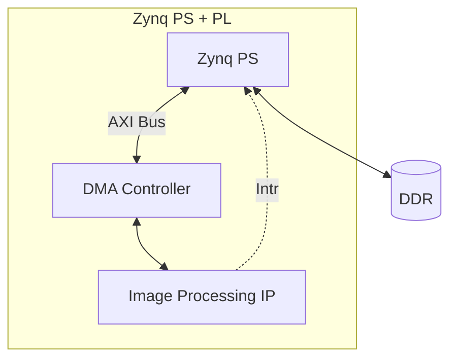

<a id="top"></a>

# Sobel Filter on Zynq-7000 (PS + PL)


---

## Overview

This repository contains the implementation of a hardware-accelerated image processing system for the **Xilinx Zynq-7000** architecture (ARM Cortex-A9 + FPGA).

The application executes the **Sobel Edge Detection Filter** as a streaming hardware accelerator in the Programmable Logic (PL), communicating with the Processing System (PS) DDR memory through **AXI DMA** using an **AXI4-Stream** interface. This is the final target architecture: PS and DDR on one side, and a DMA-fed image processing core in the PL on the other, with no video output stage.

---

## Index

- [System Architecture](#system-architecture)
- [Theoretical Background](#theoretical-background)
  - [Image Processing](#image-processing)
  - [Kernels and Convolution](#kernels-and-convolution)
  - [Sobel Operator](#sobel-operator)
  - [Sizing the Line Buffer](#sizing-the-line-buffer)
- [Implementation Guide](#implementation-guide)
- [Development Tools](#development-tools)
- [Reference Documentation (AMD/Xilinx)](#reference-documentation-amdxilinx)
- [Repository Structure](#repository-structure)
- [Project Recommendations](#project-recommendations)
- [License](#license)
- [Additional Notes](#additional-notes)
- [References](#references)

---

## System Architecture

This is the final target architecture of the project. The Zynq **PS** only talks to **DDR** and to the **AXI Bus**; all pixel data moves between DDR and the **Image Processing IP** through the **DMA Controller**, and the PS is only notified once the transfer is finished, through an interrupt line. There is no video output stage, the processed frame stays in DDR, ready to be read back by software.



1. The PS configures the DMA Controller over the AXI Bus (source/destination addresses, frame size) and starts the transfer.
2. DMA reads the raw frame from DDR and streams it into the Image Processing IP over AXI4-Stream.
3. The IP applies the Sobel operator (see below) and streams the edge-detected pixels back to the DMA Controller.
4. DMA writes the processed frame back to DDR.
5. Once the Image Processing IP finishes processing the frame, it raises an interrupt to the PS, no polling is needed, and the pixel data never has to pass through the ARM cores.

---

## Theoretical Background

### Image Processing

Image processing is the set of techniques used to analyze, enhance, or transform digital images by manipulating their pixel values.

A grayscale digital image can be represented as a 2D function ```I(x, y)```, where `x` and `y` are pixel coordinates and `I` is the intensity value at that point (commonly 0–255 for 8-bit images). Most classic processing operations, such as smoothing, sharpening, and edge detection, are local operations: the output at `(x, y)` depends only on a small neighborhood of input pixels around `(x, y)`, not the whole image.

### Kernels and Convolution

A kernel (*also called a convolution matrix or mask*) is a small, fixed-size weight matrix, typically 3×3 or 5×5, that gets slid across an image to produce a new pixel value at every position. The mechanism is always the same convolution described below; only the numeric weights inside the kernel change, and those weights are what decide whether the resulting effect looks like a blur, a sharpened image, an embossed relief, or a set of detected edges.

The 2D discrete convolution of an image `I` with a kernel `K` of size `(2a+1) × (2b+1)` is:

$$
G(x, y) = \sum_{i=-a}^{a} \sum_{j=-b}^{b} K(i, j) \cdot I(x - i, \; y - j)
$$

In practice this means: slide the kernel over the image, at each position multiply each kernel weight by the pixel underneath it, and sum all the products to get the output pixel. Strict convolution flips the kernel horizontally and vertically before this step; when the kernel is symmetric (as with blur or box kernels) the flip has no visible effect, and skipping it turns the operation into *cross-correlation*  instead, which is what most edge-detection kernels, including Sobel, actually use in practice.

### Sobel Operator

The **Sobel filter** is an edge-detection operator based on this same convolution idea. It approximates the intensity **gradient** of the image at each pixel using two fixed 3×3 kernels, one for the horizontal direction and one for the vertical direction:

```
         -1  0  +1             -1 -2 -1
   Gx =  -2  0  +2       Gy =   0  0  0
         -1  0  +1             +1 +2 +1
```

Convolving the image `A` with each kernel gives two gradient components:

$$
G_x = K_x * A \qquad\qquad G_y = K_y * A
$$

From these, the **gradient magnitude** and **direction** at each pixel are computed as:

$$
|G| = \sqrt{G_x^{2} + G_y^{2}} \;\;\; \text{(commonly approximated as } |G_x| + |G_y| \text{ in hardware)}
$$

`|G|` is large where the image intensity changes sharply, which happens at object boundaries and is exactly what makes Sobel useful for edge detection. In this project `Gx` and `Gy` are computed in Vitis HLS, and the square-root is replaced by the cheaper absolute-value sum to keep the design lightweight and easy to pipeline.


### Sizing the Line Buffer

Because the 3×3 Sobel window needs pixels from the row above, the current row, and the row below, a streaming implementation does **not** need to store the whole frame, only the last 3 rows.

For a `512 × 512` **8-bit grayscale** image (1 byte per pixel):

$$
\text{1 line} = 512 \; \text{pixels} \times 1\; \text{byte/pixel} = 512 \; \text{bytes}
$$

$$
\text{3 lines (Sobel window)} = 3 \times 512 = 1536\; \text{bytes} = 1.5 \; \text{KB}
$$

| Quantity   | Calculation   | Memory                 |
| ---------- | ------------- | ---------------------- |
| 1 line     | 512 × 1       | 512 bytes              |
| 2 lines    | 512 × 2       | 1024 bytes             |
| 3 lines    | 512 × 3       | 1536 bytes             |
| Full frame | 512 × 512 × 1 | 262,144 bytes = 256 KB |

```
Full image (512 x 512)
Row 0  ────────┐
Row 1  ────────┤ → Line Buffer (1.5 KB)
Row 2  ────────┘
              ↓
          3x3 window
              ↓
       Sobel (Gx, Gy, |G|)
```

Streaming only 3 rows instead of the full 256 KB frame is what allows the Sobel core to be pipelined and to keep up with the pixel rate coming from the DMA Controller over AXI4-Stream, without needing frame-sized BRAM.

---

## Implementation Guide

The implementation is described in the document below.

| Part | Document                                                        | Main Topics                                              |
|:----:| --------------------------------------------------------------- | -------------------------------------------------------- |
| 1    | [tutorial_sobel_filter_p1.md](docs/tutorial_sobel_filter_p1.md) | Vitis HLS, Sobel IP, AXI4-Stream, AXI DMA, Vivado, Vitis |

---

## Development Tools

The following tools are used throughout the project.

| Tool   | Version  | Description                                                                |
| ------ |:--------:| -------------------------------------------------------------------------- |
| Vivado | 2025.2.1 | FPGA hardware design, synthesis, implementation, and bitstream generation. |
| Vitis  | 2025.2.1 | Bare-metal software development for the ARM Cortex-A9 Processing System.   |
| Python | 3.12.3   | For tools and automation.                                                  |
| Board  | PYNQ-Z2  | Real implementation.                                                       |

---

## Reference Documentation (AMD/Xilinx)

The following official AMD/Xilinx documentation is recommended throughout the implementation.

> Search using the document code — e.g., `"PG021 site:docs.amd.com"`.

| Document | Title                                                     | Main Topics                                                                                                              |
| -------- | --------------------------------------------------------- | ------------------------------------------------------------------------------------------------------------------------ |
| PG021    | AXI DMA Product Guide                                     | AXI DMA architecture, register map, Simple Mode vs Scatter-Gather, buffer descriptors and transfer control.              |
| UG585    | Zynq-7000 Technical Reference Manual                      | Processing System architecture, GP/HP AXI ports, DDR controller, GIC, clocks and interconnect.                           |
| UG1399   | Vitis HLS User Guide                                      | C/C++ coding style, HLS pragmas (`INTERFACE`, `PIPELINE`, `ARRAY_PARTITION`), optimization techniques and `hls::stream`. |
| UG994    | Vivado Design Suite User Guide: Designing IP Subsystems   | IP Integrator, Address Editor, Block Design creation and TCL export.                                                     |
| UG908    | Vivado Design Suite User Guide: Programming and Debugging | FPGA programming, debugging and Integrated Logic Analyzer (ILA).                                                         |


**How to use these documents without getting overwhelmed:**

Together, these manuals span thousands of pages, and no one is expected to read them cover to cover. The recommended approach is: follow the tutorial → if something is unclear or breaks, open the relevant document and jump directly to the appropriate section.

There are two exceptions that are well worth reading from beginning to end: the **introductory chapter of the AXI specification UG1037** (about 30 pages, which consolidates the concepts covered in Part 1 of this tutorial) and **UG934** (about 20 pages).

---

## Repository Structure

The project follows a modular organization that separates version-controlled source code from automatically generated project files.

<details>
<summary>View full repository tree</summary>

``` text
Sobel_Filter_Zynq7000/
│
├── docs/                             # Detailed implementation guide
│   └── tutorial_sobel_filter_p1.md   # Main tutorial: simulation and implementation
│
├── hls/                       # Vitis HLS
│   ├── src/                   # C/C++ source files
│   └── proj/                  # Generated project files (discard)
│
├── hw/                        # Vivado
│   ├── hdl/                   # Custom RTL (Verilog/VHDL)
│   ├── xdc/                   # Constraint files
│   ├── ip_repo/               # Exported HLS IPs
│   ├── bd/                    # Block Design TCL scripts
│   └── proj/                  # Generated project files (discard)
│
├── sw/                        # Vitis (Bare-Metal Software)
│   ├── src/                   # C source code
│   ├── xsa/                   # Exported hardware platforms
│   └── workspace/             # Generated workspace (discard)
|
├── tools/                     # Python script to convert .pgm images into C arrays
│
├── images/                    # Test images and output results
│
├── .editorconfig
├── .gitattributes
├── .gitignore
|
├── License
└── README.md
```
</details>

---

## Project Recommendations

### Git Repository

Do **not** commit generated project files.

Keep the repository lightweight by versioning only:

- Source code (C)
- RTL source files (Verilog)
- Constraint files (`.xdc`)
- Hardware platform files (`.xsa`) when required
- Block Design TCL scripts (`File → Export → Export Block Design`)
- Documentation

Generated directories such as `proj/` and `workspace/` should remain outside version control.

---

## License

This project is distributed under the **GNU General Public License v3.0 (GPL-3.0)**.

---

## Additional Notes

This repository is intended as practical educational material for learning FPGA-based image processing using the Xilinx Zynq-7000 platform, Vitis HLS, Vivado, and AXI DMA.

---

## References

The [Theoretical Background](#theoretical-background) section above was written based on, and adapted from, the following sources:

- Wikipédia (PT). **Filtro Sobel**. Available at: <https://pt.wikipedia.org/wiki/Filtro_Sobel>
- Wikipedia (EN). **Kernel (image processing)**. Available at: <https://en.wikipedia.org/wiki/Kernel_(image_processing)>

Content was reorganized for this README; consult the original sources for the full explanations and further details.

---

[↑ Back to top](#top)
