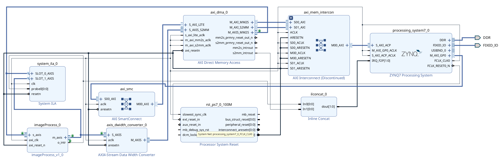

<a id="top"></a>

# Implementation Guide — Sobel Edge Detection Filter
[← Back to Readme](../README.md)

## Table of Contents

- [1. Project Overview](#1-project-overview)
- [2. AXI in Practice](#2-axi-in-practice)
  - [2.1 The Three AXI Flavors](#21-the-three-axi-flavors)
  - [2.2 The Handshake](#22-the-handshake)
  - [2.3 The Role of AXI DMA](#23-the-role-of-axi-dma)
- [3. RTL Design (Vivado project `imageProcessing`)](#3-rtl-design-vivado-project-imageprocessing)
  - [3.1 Create the Project](#31-create-the-project)
  - [3.2 Add the Verilog Sources](#32-add-the-verilog-sources)
  - [3.3 Create the Output FIFO (`outputBuffer`)](#33-create-the-output-fifo-outputbuffer)
  - [3.4 How the Modules Work Together](#34-how-the-modules-work-together)
- [4. Behavioral Simulation](#4-behavioral-simulation)
- [5. Packaging the IP](#5-packaging-the-ip)
- [6. Block Design (Vivado project `imageProcessingSystem`)](#6-block-design-vivado-project-imageprocessingsystem)
  - [6.0 Quick Path: Rebuild from the TCL Script](#60-quick-path-rebuild-from-the-tcl-script)
  - [6.1 Create the Project and Add the IP Repository](#61-create-the-project-and-add-the-ip-repository)
  - [6.2 Configure the Zynq Processing System](#62-configure-the-zynq-processing-system)
  - [6.3 Configure the AXI DMA](#63-configure-the-axi-dma)
  - [6.4 Add the Remaining Blocks](#64-add-the-remaining-blocks)
  - [6.5 Connections](#65-connections)
  - [6.6 Address Assignment](#66-address-assignment)
  - [6.7 Generate the Bitstream and Export the Hardware](#67-generate-the-bitstream-and-export-the-hardware)
- [7. Bare-Metal Application in Vitis](#7-bare-metal-application-in-vitis)
  - [7.1 Create the Platform and the Application](#71-create-the-platform-and-the-application)
  - [7.2 Add the Source Code](#72-add-the-source-code)
  - [7.3 Using Your Own Image](#73-using-your-own-image)
  - [7.4 Run on the Board](#74-run-on-the-board)
  - [7.5 View the Processed Image on the PC](#75-view-the-processed-image-on-the-pc)
- [8. Troubleshooting](#8-troubleshooting)
- [9. Debugging Tips](#9-debugging-tips)
- [10. Recap](#10-recap)

---

## 1. Project Overview

**Flow:** the bare-metal application on the ARM processor holds a 512 × 512 grayscale image in DDR. An **AXI DMA** streams the image, line by line, into a **custom Sobel IP written in Verilog**. The IP returns a binary edge map (edge = `0xFF`, background = `0x00`), which the DMA writes back to DDR. The application then sends the result to the PC through UART.

**Target board:** PYNQ-Z2 (`xc7z020clg400-1`). Any other Zynq-7000 board works with the same steps; only the board preset and the UART device change.

**Tools:** Vivado and Vitis 2025.2.1 (menu names may vary slightly in other versions).

The work is split into **four projects**. They are created locally inside `hw/proj/`, which is **not** versioned (it is listed in `.gitignore`):

| Project | Tool | Purpose |
| ------- | ---- | ------- |
| `imageProcessing` | Vivado | Verilog modules, behavioral simulation, packaging the `imageProcess` IP into `hw/ip_repo/` |
| `imageProcessingSystem` | Vivado | Block design with the Zynq PS, AXI DMA and the IP; bitstream and `.xsa` |
| `imageProcessingPlatform` | Vitis | Platform generated from the `.xsa` (standalone, `ps7_cortexa9_0`) |
| `imageIPTest` | Vitis | Bare-metal application (`imageIPTest.c` + `imageData.h`) |

**What the repository keeps, and where to start.** Everything inside `hw/proj/` can be recreated from the versioned files, so you do not have to follow every section:

| You want to… | Files used | Start at |
| ------------ | ---------- | -------- |
| Only run the filter on the board | `hw/xsa/imageProcessingSystem_wrapper.xsa`, `sw/` | Section 7 |
| Recreate the block design without building it by hand | `hw/ip_repo/`, `hw/bd/imageProcessingSystem.tcl` | Section 6.0 |
| Change or simulate the Verilog | `hw/hdl/`, `hw/tb/`, `hw/ip_repo/src/outputBuffer/outputBuffer.xci`, `tools/package_ip.tcl` | Section 3 |

The development order followed in this project was: `lineBuffer` → `conv` (MAC) → `imageControl` → `imageProcessTop` → simulation → packaging → block design and bitstream → `imageData.h` → application.

---

## 2. AXI in Practice

### 2.1 The Three AXI Flavors

AXI (Advanced eXtensible Interface) is the "language" that the ARM processor (PS) and the FPGA logic (PL) use to communicate. This project uses all three flavors.

**AXI4-Lite — "Control Panel"**

* Transfers **one 32-bit word at a time**, without bursts.
* Typical use: **configuration and status registers**.
* In this project: the ARM programs the AXI DMA registers ("transfer N bytes from address X") through `M_AXI_GP0`.

**AXI4 (Full / Memory-Mapped) — "Addressed Cargo Truck"**

* **Bursts of up to 256 words** per address transaction.
* Typical use: high-bandwidth access to **DDR memory**.
* In this project: the DMA reads and writes DDR through the Zynq **ACP** (Accelerator Coherency Port).

**AXI4-Stream — "Conveyor Belt"**

* **No addresses.** A continuous flow of data: `TDATA` + `TVALID`/`TREADY` (handshake), optionally `TLAST` (end of packet).
* Typical use: pixels, audio samples, DSP data.
* In this project: pixels flow DMA → IP (8 bit) and IP → width converter → DMA (8 → 32 bit).

### 2.2 The Handshake

Every AXI transfer happens on a clock edge where **both** signals are high:

```text
VALID = 1  (sender:   "I have valid data")
READY = 1  (receiver: "I can accept it")
```

Understanding this is already most of AXI. In this project's RTL the signals have their own names:

| AXI4-Stream signal | `imageProcessTop` port (input side) | `imageProcessTop` port (output side) |
| ------------------ | ----------------------------------- | ------------------------------------ |
| `TDATA`  | `i_data`       | `o_data`       |
| `TVALID` | `i_data_valid` | `o_data_valid` |
| `TREADY` | `o_data_ready` | `i_data_ready` |

### 2.3 The Role of AXI DMA

The ARM does **not** send pixels to the PL one by one; that would be far too slow. The **AXI DMA** converts between memory-mapped and streaming data:

```text
DDR ──AXI4 (ACP)──► AXI DMA ──AXI4-Stream (MM2S, 8 bit)──► imageProcess IP
DDR ◄──AXI4 (ACP)── AXI DMA ◄──AXI4-Stream (S2MM, 32 bit)── Width Converter ◄── imageProcess IP
```

* **MM2S (Memory-Mapped to Stream):** reads image lines from DDR and streams them to the IP.
* **S2MM (Stream to Memory-Mapped):** receives the processed stream and writes it to DDR.
* The ARM only programs the DMA through **AXI4-Lite** and then reacts to **interrupts**.

---

## 3. RTL Design (Vivado project `imageProcessing`)

### 3.1 Create the Project

1. Open **Vivado** → **Create Project**.
   - **Project name:** `imageProcessing`
   - **Project location:** `hw/proj/`
   - **RTL Project**, without adding sources yet.
2. Select the board **PYNQ-Z2** (`tul.com.tw:pynq-z2:part0:1.0`). If the board files are not installed, select the part `xc7z020clg400-1`.

### 3.2 Add the Verilog Sources

**Add Sources → Add or create design sources** and add from `hw/hdl/`, with **Copy sources into project** checked:

| File | Module | Function |
| ---- | ------ | -------- |
| `lineBuffer.v` | `lineBuffer` | One 512-byte line; outputs 3 consecutive pixels (24 bits) |
| `imageControl.v` | `imageControl` | 4 rotating line buffers; builds the 3×3 window; generates `o_intr` |
| `conv.v` | `conv` | Sobel filter (4-stage pipeline, threshold 4000) |
| `imageProcessTop.v` | `imageProcessTop` | Top level: `imageControl` → `conv` → `outputBuffer` |

> **Where the files really live.** Because the sources are copied, Vivado works on its own copies inside the project:
>
> ```text
> hw/proj/imageProcessing/imageProcessing.srcs/sources_1/imports/hdl/   ← design sources
> hw/proj/imageProcessing/imageProcessing.srcs/sim_1/imports/tb/        ← testbench (section 4)
> ```
>
> Edits made in Vivado change these copies, **not** the files in `hw/hdl/` and `hw/tb/`. After changing something, copy the files back to `hw/hdl/` and `hw/tb/` so the repository stays up to date.

> **Sobel or blur?** `conv.v` (Sobel) and `conv-simulacao.v` (3×3 mean/blur) both declare `module conv`. Add **only one** of them to the project, depending on which filter you want.

### 3.3 Create the Output FIFO (`outputBuffer`)

`imageProcessTop` instantiates a Xilinx FIFO named `outputBuffer`. Create it in the **IP Catalog → FIFO Generator** with:

| Setting | Value |
| ------- | ----- |
| Component Name | `outputBuffer` |
| Interface Type | **AXI Stream** |
| Clocking | Common Clock |
| TDATA width | 1 byte (8 bits) |
| TLAST / TKEEP / TUSER | Not used |
| FIFO depth | 16 |
| Programmable Full | Single threshold, **assert at 8** |

The `axis_prog_full` output becomes the IP's `o_data_ready = !axis_prog_full`. When the FIFO is almost full, the IP tells the DMA to stop sending (backpressure).

A ready-made configuration is available in `hw/ip_repo/src/outputBuffer/outputBuffer.xci`; you can add that file instead of creating the FIFO by hand.

### 3.4 How the Modules Work Together

```text
 i_data (8 bit) ──► imageControl ──► 3×3 window (72 bit) ──► conv ──► outputBuffer ──► o_data (8 bit)
                     │  4 × lineBuffer (512 B each)            │ Sobel     │ FIFO 16, prog_full 8
                     └─► o_intr (one pulse per output line)    │           └─► o_data_ready
```

1. **Writing:** incoming pixels go into one of the 4 line buffers. After 512 pixels the write pointer moves to the next buffer.
2. **Reading:** once **1,536 pixels** (3 full lines) are stored, `imageControl` reads 3 buffers in parallel, 3 pixels from each, and outputs a 9-pixel window per clock for 512 clocks (one output line).
3. **Interrupt:** at the end of each output line, `o_intr` pulses. The software uses it to send the next input line.
4. **Filter:** `conv` multiplies the window by the two Sobel kernels, adds the products (Gx, Gy), squares them and compares `Gx² + Gy²` with **4000**. The result is `0xFF` (edge) or `0x00` (background), four clocks later.
5. **Output:** results are queued in `outputBuffer` and leave through `m_axis`.

The kernels and the threshold are explained in the [README — Sobel Operator](../README.md#sobel-operator).

---

## 4. Behavioral Simulation

The testbench `tb_ imageProcess.v` reads a binary PGM (P5) image and feeds it to `imageProcessTop` the same way the software does on the board: 4 lines first, then one line per `o_intr`, then 2 lines of zeros to flush the pipeline. It produces **two files**:

| Output file | Content |
| ----------- | ------- |
| `sobel_filter_image.pgm` | The filtered image (same PGM header as the input + 512 × 512 result pixels) |
| `imageData.h` | Every pixel sent to the filter, as comma-separated decimal values: the 512 image lines **plus the 2 lines of zeros**, 514 × 512 = 263,168 values. This is the raw material for the firmware's `imageData.h` (section 7.3) |

> **Which testbench?** Vivado runs the copy in `imageProcessing.srcs/sim_1/imports/tb/`; `hw/tb/tb_ imageProcess.v` is the repository copy of the same file. If you edit the testbench in Vivado, copy it back to `hw/tb/`.

1. **Add Sources → Add or create simulation sources** → `tb_ imageProcess.v` (with **Copy sources into project** checked). Set `tb_imageProcess` as the simulation top.
2. Run **Simulation → Run Behavioral Simulation** once. This creates the simulation folder:

   ```text
   hw/proj/imageProcessing/imageProcessing.sim/sim_1/behav/xsim/
   ```

3. Copy the input image `images/grayscale_landscape.pgm` into that folder. The testbench opens it by name, relative to that folder.
4. Restart the simulation and type in the **Tcl Console**:

   ```tcl
   run all
   ```

   The whole image needs about **2.65 ms** of simulated time (the comment inside the testbench still says 5.3 ms). The console prints the progress every 64 lines and, at the end:

   ```text
   Imagem salva: 262144 pixels + 59 bytes de cabecalho = 262203 bytes
   ```

5. Both output files are written in the same folder: `sobel_filter_image.pgm` (open it with GIMP or any PGM viewer) and `imageData.h`.

<p align="center">
  <br>
  <em>Output of the behavioral simulation with the Sobel <code>conv.v</code> (threshold 4000)</em>
</p>

> **Note:** the testbench checks the image header. It stops with an error if the file is not `P5`, is not 512 × 512, or uses more than 1 byte per pixel. A watchdog stops the simulation after 20 ms of simulated time and reports how many pixels were sent and received.

> **Note:** `.pgm` files are not rendered by GitHub. To preview one, export it as PNG in GIMP (**File → Export As → `.png`**).

---

## 5. Packaging the IP

The IP is packaged with the script `tools/package_ip.tcl`, which sets the name, the interfaces, the clock and the reset in one step.

> **Why a script?** The menu **Tools → Create and Package New IP** names the IP after the top module (`imageProcessTop`) and does not detect the AXI4-Stream interfaces, because the port names do not follow the `s_axis_tdata` pattern. The result is a different IP, without `s_axis`/`m_axis`, which the block design cannot use. Mapping the interfaces by hand in the GUI is possible but error-prone.

1. Open the `imageProcessing` project. Close any open **Edit IP** window first.
2. In the **Tcl Console**, run (adjust the path if the repository is somewhere else):

   ```tcl
   source ~/Desktop/Sobel_Filter_Zynq7000/tools/package_ip.tcl
   ```

3. At the end the console shows:

   ```text
   IP packaged: user.org:user:imageProcess:1.0 (revision 10)
   Interfaces : axi_clk, axi_reset_n, m_axis, o_intr, s_axis
   ```

The script packages the current project into `hw/ip_repo/` (`component.xml`, `src/`, `xgui/`) with these interfaces:

| Interface | Type | Ports |
| --------- | ---- | ----- |
| `s_axis` | AXI4-Stream slave | `i_data` (TDATA), `i_data_valid` (TVALID), `o_data_ready` (TREADY) |
| `m_axis` | AXI4-Stream master | `o_data` (TDATA), `o_data_valid` (TVALID), `i_data_ready` (TREADY) |
| `axi_clk` | Clock | `ASSOCIATED_BUSIF = m_axis:s_axis`, `ASSOCIATED_RESET = axi_reset_n` |
| `axi_reset_n` | Reset | `POLARITY = ACTIVE_LOW` |
| `o_intr` | Interrupt | sensitivity `LEVEL_HIGH` (as packaged); the software configures the GIC for rising edge |

> **Important:** every time you change the Verilog, run the script again, **increasing `core_revision`** inside it (currently 10) so Vivado sees the change. Then, in the `imageProcessingSystem` project, run:
>
> ```tcl
> update_ip_catalog -rebuild
> upgrade_ip [get_ips imageProcessingSystem_imageProcess_0_0]
> ```
>
> and regenerate the bitstream (section 6.7). Otherwise the hardware keeps the old filter.

---

## 6. Block Design (Vivado project `imageProcessingSystem`)

<p align="center">
  <br>
  <em>Complete block design <code>imageProcessingSystem</code></em>
</p>

### 6.0 Quick Path: Rebuild from the TCL Script

The block design is saved in `hw/bd/imageProcessingSystem.tcl` (created with `write_bd_tcl`). It rebuilds everything described in sections 6.2 to 6.6 in one command:

1. **Create Project** → name `imageProcessingSystem`, location `hw/proj/`, RTL project, board **PYNQ-Z2**.
2. **Settings → IP → Repository → +** → select `hw/ip_repo/`.
3. In the **Tcl Console**:

   ```tcl
   source ~/Desktop/Sobel_Filter_Zynq7000/hw/bd/imageProcessingSystem.tcl
   ```

4. Continue at section 6.7 (wrapper, bitstream and export).

> The script was generated with **Vivado 2025.2** and refuses to run in other versions. In a different version, build the design by hand (sections 6.1 to 6.6).

Sections 6.1 to 6.6 describe how the design is built by hand and explain each setting.

### 6.1 Create the Project and Add the IP Repository

1. **Create Project** → name `imageProcessingSystem`, location `hw/proj/`, RTL project, board **PYNQ-Z2**.
2. **Settings → IP → Repository → +** → select `hw/ip_repo/` (the folder that contains `component.xml`). Vivado should report that 1 IP was added.
3. **IP Integrator → Create Block Design** → name it `imageProcessingSystem`.

### 6.2 Configure the Zynq Processing System

Add **ZYNQ7 Processing System** and click **Run Block Automation** (applies the PYNQ-Z2 preset: DDR, MIO, UART0 at 115200 baud). Then double-click the block:

| Page | Setting | Why |
| ---- | ------- | --- |
| PS-PL Configuration → GP Master AXI Interface | **M AXI GP0** enabled | The ARM writes the DMA registers |
| PS-PL Configuration → ACP Slave AXI Interface | **S AXI ACP** enabled | The DMA reads and writes DDR through the ACP |
| Interrupts → Fabric Interrupts → PL-PS Interrupt Ports | **IRQ_F2P[15:0]** enabled | Lets the PL raise interrupts to the ARM |
| Clock Configuration → PL Fabric Clocks | **FCLK_CLK0 = 100 MHz** | Single clock for the whole PL |

**Why ACP instead of HP0?** The ACP connects the DMA to the ARM's cache controller (SCU), so DMA accesses can be kept coherent with the CPU caches. This is why `imageIPTest.c` has no explicit cache flush or invalidate calls. If the result on the board ever looks stale or partly corrupted, see [Troubleshooting](#8-troubleshooting).

### 6.3 Configure the AXI DMA

Add **AXI Direct Memory Access** and double-click it:

| Setting | Value | Note |
| ------- | ----- | ---- |
| Enable Scatter Gather Engine | ❌ **Disabled** | Simple mode, required by `XAxiDma_SimpleTransfer()` |
| Width of Buffer Length Register | **23** | 2²³ = 8 MB maximum per transfer, more than the 256 KB frame. The default (14 bits = 16 KB) would truncate it |
| Enable Read Channel (MM2S) | ✅ | Memory map data width 32, **stream data width 8**, max burst 256 |
| Enable Write Channel (S2MM) | ✅ | Memory map data width 32, **stream data width 32**, max burst 256 |
| Allow Unaligned Transfers | ✅ (both channels) | `imageData[]` is a plain C array with no alignment guarantee |

The MM2S stream is 8 bits because each pixel is one byte. The S2MM stream stays at 32 bits; the conversion is done by the width converter in the next step.

### 6.4 Add the Remaining Blocks

| Block | Configuration |
| ----- | ------------- |
| **imageProcess** (from `hw/ip_repo`) | No parameters |
| **AXI4-Stream Data Width Converter** | Master TDATA width = **4 bytes** (the slave side takes 1 byte from the IP) |
| **Concat** (Inline Concat) | 2 inputs of 1 bit each |
| **System ILA** (optional, for debugging) | 2 AXI4-Stream slots + 1 probe of 1 bit |

**Connection Automation** adds the AXI SmartConnect (for `M_AXI_GP0` → `S_AXI_LITE`), the AXI Interconnect (for the DMA masters → `S_AXI_ACP`) and the **Processor System Reset**.

### 6.5 Connections

| From | To | Protocol | Purpose |
| ---- | -- | -------- | ------- |
| `processing_system7_0/M_AXI_GP0` → `axi_smc` | `axi_dma_0/S_AXI_LITE` | AXI4-Lite | ARM programs the DMA |
| `axi_dma_0/M_AXI_MM2S` and `M_AXI_S2MM` → `axi_mem_intercon` | `processing_system7_0/S_AXI_ACP` | AXI4 | DMA accesses DDR |
| `axi_dma_0/M_AXIS_MM2S` | `imageProcess_0/s_axis` | AXI4-Stream, 8 bit | DDR → filter |
| `imageProcess_0/m_axis` | `axis_dwidth_converter_0/S_AXIS` | AXI4-Stream, 8 bit | Filter → converter |
| `axis_dwidth_converter_0/M_AXIS` | `axi_dma_0/S_AXIS_S2MM` | AXI4-Stream, 32 bit | Converter → DDR |
| `imageProcess_0/o_intr` | `ilconcat_0/In0` | Interrupt | → `IRQ_F2P[0]` (ID **61**) |
| `axi_dma_0/s2mm_introut` | `ilconcat_0/In1` | Interrupt | → `IRQ_F2P[1]` (ID **62**) |
| `ilconcat_0/dout` | `processing_system7_0/IRQ_F2P` | Interrupt | Fabric interrupts to the GIC |

The three AXI4-Stream links and the interrupt nets are made **by hand** (drag from port to port).

**Clock and reset:** `FCLK_CLK0` (100 MHz) goes to every clock input: `M_AXI_GP0_ACLK`, `S_AXI_ACP_ACLK`, all DMA clocks, `imageProcess_0/axi_clk`, the width converter, the interconnects and the ILA. `rst_ps7_0_100M/peripheral_aresetn` goes to every active-low reset, including `imageProcess_0/axi_reset_n`. A missing clock or reset usually makes the application hang without any error message.

**Interrupt IDs:** on the Zynq-7000, `IRQ_F2P[0]` to `IRQ_F2P[7]` arrive at the GIC as IDs 61 to 68 (UG585). The order of the Concat inputs therefore defines the IDs used in the software:

```c
#define IMAGEPROC_INTR_ID   61U   // IRQ_F2P[0] -> o_intr
#define DMA_S2MM_INTR_ID    62U   // IRQ_F2P[1] -> s2mm_introut
```

### 6.6 Address Assignment

Open the **Address Editor**:

| Master | Slave | Address | Range |
| ------ | ----- | ------- | ----- |
| `processing_system7_0` (Data) | `axi_dma_0/S_AXI_LITE` | `0x4040_0000` | 64K |
| `axi_dma_0` (Data_MM2S) | `S_AXI_ACP/ACP_DDR_LOWOCM` | `0x0000_0000` | 512M |
| `axi_dma_0` (Data_S2MM) | `S_AXI_ACP/ACP_DDR_LOWOCM` | `0x0000_0000` | 512M |

The DMA must reach DDR from **both** channels, or the transfers never complete. If a segment appears as **Unassigned**, right-click → **Assign**. The segments `ACP_IOP` and `ACP_M_AXI_GP0` can stay **Excluded**.

### 6.7 Generate the Bitstream and Export the Hardware

1. **Validate Design** (`F6`). There should be no errors. One critical warning is expected: *"Interface connected to S_AXIS_S2MM does not have TLAST port"*, because the IP does not generate `TLAST` (see [Troubleshooting](#8-troubleshooting)).
2. In **Sources**, right-click `imageProcessingSystem` → **Create HDL Wrapper** → *Let Vivado manage wrapper and auto-update*.
3. **Generate Bitstream**.
4. **File → Export → Export Hardware** → **Include bitstream** → save as `hw/xsa/imageProcessingSystem_wrapper.xsa`.
5. If the block design changed, export it again as TCL so the repository stays up to date:

   ```tcl
   write_bd_tcl -force ~/Desktop/Sobel_Filter_Zynq7000/hw/bd/imageProcessingSystem.tcl
   ```

---

## 7. Bare-Metal Application in Vitis

### 7.1 Create the Platform and the Application

1. Open Vitis with the workspace `hw/proj/` (created locally, not versioned).
2. **File → New Component → Platform** → name `imageProcessingPlatform` → select `hw/xsa/imageProcessingSystem_wrapper.xsa` → OS **standalone**, processor **ps7_cortexa9_0** → **Build**.
3. **File → New Component → Application** → name `imageIPTest` → platform `imageProcessingPlatform` → domain `standalone_ps7_cortexa9_0` → template **Empty Application (C)**.

> If the `.xsa` is exported again later, the platform must be updated with the new file (in the platform settings, **Switch XSA / Update Hardware Specification**), then rebuilt together with the application. Otherwise the application keeps using the old hardware.

### 7.2 Add the Source Code

Copy into `imageIPTest/src/`:

```text
sw/
├── imageIPTest.c   # Application
└── imageData.h     # Input image as a C array (512 × 512 = 262,144 bytes)
```

Then build (**Build** in the Flow Navigator).

What the application does:

1. Initializes UART0 (115200 baud), the AXI DMA and the interrupt controller (GIC).
2. Registers two interrupt handlers:
   - `imageProcISR()` on ID 61 (`o_intr`): waits for MM2S to be idle and sends the next image line (512 bytes).
   - `dmaReceiveISR()` on ID 62 (`s2mm_introut`): acknowledges the DMA interrupt and sets `done = 1`.
3. Starts the **S2MM** transfer (262,144 bytes) into `imageData`, and the **MM2S** transfer of the first **4 lines**.
4. The rest happens through interrupts: each `o_intr` sends one more line. In total 514 lines are sent (`i` goes from 4 to 513): the 512 image lines plus the **2 lines of zeros stored at the end of `imageData.h`**, which push the last results out of the pipeline. This is why `imageData.h` must contain 514 lines, not 512.
5. When `done = 1`, sends the result through UART in 1 KB chunks, between text messages (`Image size: 262144 bytes` before the data, `Image transmission completed.` after it).

The output overwrites the input **in the same buffer**. This is safe because each output line is written only after the input lines it depends on have already been sent.

> **System Device Tree (SDT) flow:** starting with Vitis 2025.x, drivers are looked up by **base address** instead of a device ID. That is why the code uses `XAxiDma_LookupConfig(XPAR_AXI_DMA_0_BASEADDR)`, `XUartPs_LookupConfig(XPAR_XUARTPS_0_BASEADDR)` and `XScuGic_LookupConfig(XPAR_XSCUGIC_0_BASEADDR)`. If your block uses a different instance name, look up the right macro in `xparameters.h`:
>
> ```bash
> grep -rn "XPAR_AXI_DMA_0_BASEADDR" hw/proj/imageProcessingPlatform/ --include=xparameters.h
> ```
>
> The value should match the Address Editor (`0x40400000`).

### 7.3 Using Your Own Image

The application has no file system, so the image is compiled into the program as a C array. In this project, the array is **generated by the testbench** during the simulation (section 4), so the same pixels are used in simulation and on the board.

1. Convert the image to **512 × 512 grayscale binary PGM** in GIMP: **Image → Mode → Grayscale**, **Image → Scale Image** to 512 × 512, then **File → Export As → `.pgm`** with **Raw** encoding.
2. Save it as `grayscale_landscape.pgm` in the simulation folder (`hw/proj/imageProcessing/imageProcessing.sim/sim_1/behav/xsim/`), replacing the old one, and run the simulation (section 4).
3. The simulation creates `imageData.h` in the same folder. It contains only the numbers (`71,71,71,...,0,0,`), so it still needs the C declaration around them. In a terminal, inside the simulation folder, run:

   ```bash
   { printf 'char imageData[] = {'; cat imageData.h; printf '};\n'; } > imageData_final.h
   ```

   The result looks like this (the comma before `}` is valid C):

   ```c
   char imageData[] = {71,71,71, ... ,0,0,};
   ```

4. Copy `imageData_final.h` to `imageIPTest/src/imageData.h` (and to `sw/imageData.h` in the repository), then rebuild.

Two details matter:

* The array has **514 lines** (263,168 bytes): the 512 image lines plus 2 lines of zeros. The software sends these 2 extra lines at the end (section 7.2).
* The array must **not** be `const`, because the DMA writes the result back into the same array. A `const` array would be placed in read-only memory.

> **About `tools/convert_pgm_to_c.py`:** this script also converts a PGM into a C array, but it is **not** part of the current flow. Its output has a different variable declaration (`static const unsigned char test_image[...]`) and only the 512 image lines, without the 2 lines of zeros. If you use it, you have to rename the array to `imageData`, remove `static const` and add 1,024 zeros at the end.

### 7.4 Run on the Board

1. Connect the PYNQ-Z2 through USB (it carries both JTAG and UART) and set the boot jumper to **JTAG**.
2. Start the UART capture on the PC **before** running the program (see 7.5).
3. In Vitis, select `imageIPTest` and click **Run** (target: **Hardware**). This programs the FPGA with the bitstream from the `.xsa`, initializes the PS and runs the program.

### 7.5 View the Processed Image on the PC

The image arrives as raw bytes in the middle of text messages. On Ubuntu, capture everything into a file (the PYNQ-Z2 UART is usually `/dev/ttyUSB1`):

```bash
stty -F /dev/ttyUSB1 115200 raw -echo
cat /dev/ttyUSB1 > capture.bin
```

At 115200 baud, the 262,144 bytes take about **23 seconds**. When `Image transmission completed.` has been sent, stop with `Ctrl+C`.

Then extract the pixels and add a PGM header. Copy and paste this whole block into the terminal, in the same folder as `capture.bin`:

```bash
python3 - << 'EOF'
data = open('capture.bin', 'rb').read()
marker = b'Image size: 262144 bytes\r\n'
start = data.find(marker)
if start < 0:
    raise SystemExit('Marker not found: check the capture')
start += len(marker)
pixels = data[start:start + 512 * 512]
print('Pixels received:', len(pixels), 'of', 512 * 512)
open('result.pgm', 'wb').write(b'P5\n512 512\n255\n' + pixels)
print('Saved result.pgm')
EOF
```

Open `result.pgm` in GIMP or any image viewer. It should look like the simulation output from section 4.

> Once the UART flow works, it can be replaced by faster methods, such as reading DDR with XSCT (`mrd`), writing to the SD card (`xilffs`) or using Ethernet (`lwIP`). The hardware stays the same; only the way the image enters and leaves DDR changes.

---

## 8. Troubleshooting

| Symptom | Likely cause | Solution |
| ------- | ------------ | -------- |
| Simulation: `ERRO: nao foi possivel abrir grayscale_landscape.pgm` | Image not in the simulation folder | Copy it to `imageProcessing.sim/sim_1/behav/xsim/` (section 4). |
| Simulation: `TIMEOUT: enviados ... recebidos ...` | `o_intr` never arrives, or the output stalls | Check the `o_intr` and `o_data_valid` waveforms; check that the reset (`axi_reset_n`) is released. |
| On the board the result is **blurred** instead of edges | The IP was packaged with `conv-simulacao.v`, or the Vitis platform still uses an old `.xsa` | Package the IP with the Sobel `conv.v` (section 5), upgrade it in the block design, regenerate the bitstream, export the `.xsa` again and update the Vitis platform. |
| Validation: *"Interface connected to S_AXIS_S2MM does not have TLAST port"* | The IP and its FIFO do not generate `TLAST` | Expected; the design is built anyway. If the board then stops at `Waiting for image processing...`, see the next row. |
| The program stops at `Waiting for image processing...` | An interrupt is not arriving, or the S2MM channel never finishes without `TLAST` | Check that `IRQ_F2P` is enabled, that the Concat inputs are in the right order (In0 = `o_intr`, In1 = `s2mm_introut`) and that the IDs in the code are 61 and 62. Print the DMA status registers (section 9). If S2MM is still busy, the IP must assert `TLAST` on the last pixel (262,144th) of the frame. |
| `XAxiDma_SimpleTransfer()` returns an error | Scatter-Gather enabled, or a transfer longer than the buffer length register | Disable Scatter-Gather; keep the buffer length width at 23. |
| Only part of the image is returned | Buffer length register too small | Width of Buffer Length Register of at least 19 bits (the maximum length is 2ᴺ − 1 bytes, so 18 bits is one byte short of 256 KB); this project uses 23. |
| Output identical to the input, or partly corrupted | Cache contents and DDR out of sync | For a quick test, call `Xil_DCacheDisable();` at the start of `main()`. For a permanent fix, call `Xil_DCacheFlushRange((UINTPTR)imageData, IMAGE_SIZE)` before the transfers and `Xil_DCacheInvalidateRange((UINTPTR)imageData, IMAGE_SIZE)` before sending the result over UART. |
| Nothing happens, no error | Missing clock/reset, or the DMA cannot reach DDR | Check that every clock input is on `FCLK_CLK0` and that both DMA channels map `ACP_DDR_LOWOCM` in the Address Editor. |
| The last output lines on the board are wrong, or the program misbehaves after processing | `imageData.h` has only 512 lines | The array must have 514 lines (2 lines of zeros at the end). Generate it with the testbench (section 7.3). |
| `XPAR_..._DEVICE_ID` undeclared | SDT flow (Vitis 2025.x) | Use the `..._BASEADDR` macros (section 7.2). |
| `result.pgm` is shifted or has text in it | Wrong marker or capture started too late | Start `cat` before running the program; check that the marker in the Python block matches the text printed by the firmware. |

---

## 9. Debugging Tips

**DMA status registers.** When the DMA seems stuck, print both status registers:

```c
xil_printf("MM2S SR=0x%08x  S2MM SR=0x%08x\r\n",
    XAxiDma_ReadReg(myDma.RegBase, XAXIDMA_TX_OFFSET + XAXIDMA_SR_OFFSET),
    XAxiDma_ReadReg(myDma.RegBase, XAXIDMA_RX_OFFSET + XAXIDMA_SR_OFFSET));
```

* **Bit 0** → channel halted
* **Bit 1** → channel idle
* **Bits 4–6** → internal, slave or decode error

**System ILA.** The block design already includes `system_ila_0`, which watches the DMA → IP stream (slot 0), the IP → converter stream (slot 1) and `o_intr` (probe 0). After programming the board, open **Vivado → Open Hardware Manager → Auto Connect**, trigger on `TVALID` or `o_intr`, and see in real time where the data stops.

---

## 10. Recap

* **AXI4-Lite** → ARM programs the DMA (`M_AXI_GP0` → SmartConnect → `S_AXI_LITE`).
* **AXI4 (Memory-Mapped)** → DMA ↔ DDR through the **ACP** port.
* **AXI4-Stream** → pixels DMA → IP (8 bit) and IP → width converter → DMA (32 bit).
* **imageProcess IP** → 4 line buffers + Sobel pipeline + output FIFO; one `o_intr` per output line.
* **Interrupts** → `o_intr` (ID 61) asks for the next line; `s2mm_introut` (ID 62) says the frame is in DDR.
* **Same buffer** → `imageData[]` holds the input and receives the output.

---

[↑ Back to top](#top)

[← Back to Readme](../README.md)
