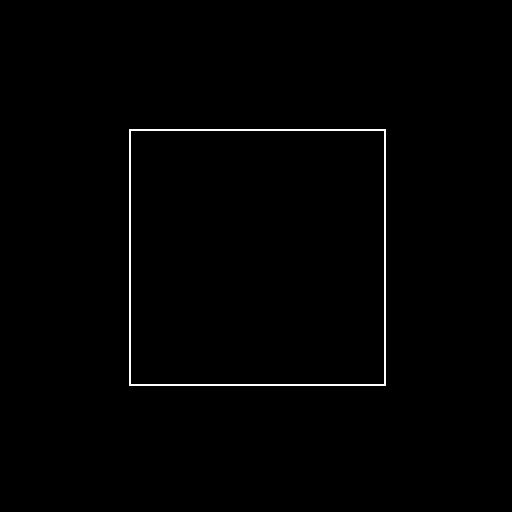

<a id="top"></a>

| Title | Part 1 — Sobel Edge Detection Filter |
| --- | --- |
| File | `tutorial_sobel_filter_p1.md` |
| Date | 05 Aug 2026 |

---

# Part 1 — Sobel Edge Detection Filter

## 1. Zynq (PS + PL) Using AXI DMA

**Project flow:** the application running on the ARM processor (via Vitis) sends a grayscale image from DDR memory to the FPGA through an **AXI DMA**. The FPGA applies the **Sobel filter** (an IP created with HLS) and writes the processed image back to DDR memory, where it can be saved and viewed on the PC.

**Target board:** any Zynq-7000 board (Zybo, PYNQ-Z2, ZedBoard, Arty Z7, etc.). The workflow is essentially the same for Zynq UltraScale+ devices (only the PS block name and HP interface names change).

**Tools:** Vivado + Vitis HLS + Vitis (2025.2.1 or newer — menu names may vary slightly).

---

## 1.1 Understanding AXI Once and for All

AXI (Advanced eXtensible Interface) is the "language" that the ARM processor (PS) and the FPGA logic (PL) use to communicate. There are **three dialects**:

**AXI4-Lite — "Control Panel"**

* Simple transfers: **one 32-bit word at a time**, with no burst transfers.
* Typical use: **configuration and status registers**. Enable/disable an IP, write a parameter, read a "ready" flag.
* In this project: this is how the ARM configures the AXI DMA ("start transferring from address X with size Y").
* Analogy: a **light switch** — it does not carry power; it only controls it.

**AXI4 (Full / Memory-Mapped) — "Addressed Cargo Truck"**

* Supports **burst transfers of up to 256 words** per address transaction.
* Typical use: high-bandwidth access to **DDR memory**.
* In this project: this is how the DMA reads from and writes to DDR memory through the Zynq **HP (High Performance)** ports.
* Analogy: a **moving truck** — it carries a large amount of data to a specific address.

**AXI4-Stream — "Conveyor Belt"**

* **No addresses!** It is simply a continuous stream of data: `TDATA` + `TVALID`/`TREADY` (handshake) + `TLAST` (marks the end of a packet).
* Typical use: streaming data such as pixels, audio samples or DSP signals.
* In this project: this is how pixels enter and leave the Sobel filter.
* Analogy: a **sushi conveyor belt** — dishes arrive in sequence; you do not request "the dish at address 0x40."

---

## 1.2 Essential Handshake Signals (Applies to All Three)

Every AXI transfer occurs when, **during the same clock cycle**:

```text
VALID = 1  (the sender says: "I have valid data")
READY = 1  (the receiver says: "I can accept it")
```

Understanding this concept is already **70% of AXI**. The remaining details involve the various channels (read address, write address, data, response, etc.), which the design tools generate automatically.

---

## 1.3 The Role of AXI DMA

The ARM processor does **not** send pixels to the PL one at a time, that would be far too slow. The heavy lifting is handled by the **AXI DMA** IP, which converts between memory-mapped and streaming interfaces:

```text
DDR Memory ──AXI4 Full (MM)──► AXI DMA ──AXI4-Stream──► Sobel IP
DDR Memory ◄──AXI4 Full (MM)── AXI DMA ◄──AXI4-Stream── Sobel IP
```

* **MM2S (Memory-Mapped to Stream):** reads the image from DDR memory and converts it into an AXI4-Stream.
* **S2MM (Stream to Memory-Mapped):** receives the processed stream and writes it back to DDR memory.
* The ARM processor only configures the DMA through **AXI4-Lite** and waits for the transfer to complete.

---

## 1.4 Complete Project Architecture

```text
┌─────────────── PS (ARM) ───────────────┐
│  main.c running in Vitis               │
│  1. Stores the image in DDR memory     │
│  2. Configures the DMA (AXI-Lite GP0)  │
│  3. Waits and reads the result from DDR│
└───────┬────────────────────▲───────────┘
   GP0 (AXI-Lite)       HP0 (AXI Full)
        │                    │
┌───────▼────────────────────┴───────────┐
│               AXI DMA                  │
│   MM2S ──────────────────► S2MM        │
└──────┬─────────────────────▲───────────┘
       │ AXI4-Stream         │ AXI4-Stream
┌──────▼─────────────────────┴───────────┐
│            Sobel IP (HLS)              │
└────────────────────────────────────────┘
```

---

## 2. Creating the Sobel IP in Vitis HLS

In this chapter, we will create the Sobel hardware accelerator using Vitis HLS. The accelerator is written in C++ and synthesized into an RTL IP with AXI4-Stream interfaces, making it easy to integrate with AXI DMA in Vivado.

The complete source code is already included in this repository under the hls/src/ directory, so there is no need to type it manually.

---

## 2.1 Create the Project

1. Open Vitis (Vitis Unified IDE).
2. On the Welcome page, select/create a **Workspace** — a folder that will hold all the components and projects.
3. With the Vitis IDE open, go to **File > New Component > HLS** (you can also click "New Component" on the Welcome page, or use the right-click menu in the Explorer).
4. This opens the **Create HLS Component** wizard, on the **Choose Name and Location** page: enter the **Component name** (e.g., `sobel_hls`) and the **Component location**, then click **Next**.
5. On the next page (**Configuration File**), choose how to create the component's configuration file:
   - **Empty File** (new, blank)
   - **Existing File** (reuse an existing one)
   - **Generate from Vitis HLS Project** (from an old `hls.app`)
6. On the following pages you will:
   - Add the source files (.cpp/.h) and define the **Top Function** (e.g., `sobel_filter`)
   - Add the **testbench** files (optional, but recommended)
   - Choose the **Part/Device** (e.g., `xc7z020clg400-1`)
   - Set the **Clock Period** (e.g., 10 ns) and the **Flow Target** to **Vivado IP Flow** (required to later add the design to the Vivado IP Catalog and use it in a Block Design)
7. On the **Summary** page, review and click **Finish**.

> **Note:** The Vivado IP Catalog is not part of this wizard. After running C Synthesis and exporting/packaging the RTL (Export RTL / Package step), the generated IP `.zip` package must be added as a repository in Vivado (**Settings > IP > Repository**) before it becomes available in the **IP Catalog** for use in your Block Design.

---

## 2.2 Add the Source Files

Copy or import the following files from the repository:

```text
hls/
└── src/
    ├── sobel.cpp
    └── sobel.h
```

The implementation provides:

AXI4-Stream input and output interfaces;
line-buffer architecture for the 3×3 Sobel window;
pipelined implementation with II = 1;
automatic generation of the TLAST signal required by AXI DMA.

---

## 2.3 Add the Testbench

Import the testbench files:

```text
hls/
└── src/
    ├── sobel_tb.cpp
    └── pgm_io.hpp
```

The testbench:
- generates a synthetic grayscale image (a white square, by default), **or** loads an external `.pgm` image passed as an argument;
- feeds the AXI4-Stream interface;
- executes the Sobel accelerator;
- saves the output as a PGM image;
- verifies that the TLAST signal is asserted correctly.

Running the C Simulation before hardware synthesis is highly recommended to validate the algorithm and avoid unnecessary synthesis iterations.

### Using Your Own Image

The design has **fixed dimensions** (`WIDTH` x `HEIGHT`, defined in `sobel.hpp`), so any custom image must match that resolution exactly.

1. Convert/resize your image to grayscale PGM (binary, P5) using GIMP: resize to `WIDTH x HEIGHT` first (**Image → Scale Image**), then **File → Export As → `.pgm`**, choosing **Raw** encoding when prompted.
2. Pass the image path via the `hls.csim.argv` field in the C Simulation dialog (see table above):

```text
<path to the image> my_image.pgm <path to the image> my_output.pgm
```

- `argv[1]` → input image path (required to use a custom image).
- `argv[2]` → output image path (optional, defaults to `my_output.pgm`).

3. **If no argument is passed**, the testbench falls back to the default synthetic square — the image is generated in-code and no `.pgm` file is loaded from disk. This is the built-in sanity check for the design, and does not depend on any external asset.
4. If the image size doesn't match `WIDTH` x `HEIGHT`, the testbench prints an error and aborts before running the simulation.

---

## 2.4 Synthesize and Export

1. Run C Simulation → verify the generated `saida_sobel.pgm` (it should display only the edges of the square, or the edges detected in your custom image).

   > **C Simulation Settings**
   >
   > When running **C Simulation** for the first time, the Vitis Unified IDE shows a configuration dialog:
   >
   > | Option | Function | Recommendation |
   > |---|---|---|
   > | `hls.sim.O` | Compiles with higher optimization (no debug info) | Leave unchecked |
   > | `hls.csim.clean` | Removes old binaries/object files before recompiling | Check if you edited the code |
   > | `hls.csim.setup` | Only compiles, does not run the simulation | Leave unchecked |
   > | `hls.csim.argv` | Passes arguments (`argc`/`argv`) to the testbench's `main()` | Leave empty for the synthetic square; set to `my_image.pgm` to test a custom image |
   > | `hls.csim.profile_tripcount` | Enables loop trip count profiling | Optional, for performance analysis only |
   >
   > **For normal use:** leave everything unchecked and click **OK**.

   The output file is written inside the component's build directory:

```text
   <workspace>/sobel_hls/sobel_hls/hls/csim/build/saida_sobel.pgm
```

   > **Note:** `.pgm` files are not rendered by GitHub/GitLab markdown viewers.
   > Convert to PNG to preview it (e.g. `convert saida_sobel.pgm saida_sobel.png`
   > with ImageMagick, or open in GIMP and export).

   **Example 1 — default synthetic square** (no `argv` set):

   <p align="center">
     <br>
     <em>Sobel filter output — synthetic square testbench (default, no external image required)</em>
   </p>

   **Example 2 — custom image via `argv`** (using an external `.pgm`):

   <p align="center">
     <br>
     <em>Sobel filter output — sample image from <a href="https://pixabay.com/pt/vectors/paisagem-pintada-casa-frango-flores-10246533/">Pixabay</a></em>
   </p>

2. Run C Synthesis → check the synthesis report to confirm:
   * II (Initiation Interval) = 1 for the main processing loop.
   * `in_stream` and `out_stream` are implemented as AXI4-Stream (`axis`) interfaces.
3. Export RTL (Solution → Export RTL) → generates the IP package (`.zip`) that can be imported into the Vivado IP Catalog.

---

## 3. Creating the Block Design in Vivado

## 3.1 Create the Project

1. Open **Vivado** → **Create Project** → select **RTL Project**, **without** adding sources.
2. Select your **target board** (if the board files are installed, e.g., Zybo, PYNQ-Z2, ZedBoard). This automatically configures the correct DDR memory and clock settings. Otherwise, select the FPGA device and configure the Processing System (PS) manually later.
3. Open **IP Integrator** → **Create Block Design** and name it `design_1`.

---

## 3.2 Add the HLS IP to the IP Catalog

1. Go to **Settings → IP → Repository → +**.
2. Add the directory containing your Vitis HLS project (or the folder where you extracted the exported `.zip` IP package).
3. The `sobel_filter` IP should now appear in the IP Catalog.

---

## 3.3 Build the Block Design

Add the following IPs in this order:

| IP                           | Purpose                                           |
| ---------------------------- | ------------------------------------------------- |
| **ZYNQ7 Processing System**  | ARM processor and DDR memory controller           |
| **AXI Direct Memory Access** | Bridge between DDR memory and AXI4-Stream         |
| **sobel_filter**             | Hardware Sobel accelerator generated by Vitis HLS |

---

## 3.4 Configure the Zynq Processing System

Double-click the **ZYNQ7 Processing System** block.

1. If you selected a target board, click **Run Block Automation** first. This applies the board preset, including DDR and clock configuration.

2. Navigate to **PS-PL Configuration → HP Slave AXI Interface** and enable **`S AXI HP0`**.

   **Why?**

   The DMA requires a **high-bandwidth interface to access DDR memory**. The GP interfaces are intended for low-speed register accesses (32-bit), while the HP interfaces are specifically designed for high-performance DMA transfers (64-bit).

3. Verify that **`M AXI GP0`** is enabled (it usually is by default).

   **Why?**

   This interface allows the ARM processor to configure the DMA by writing to its **AXI4-Lite control registers**.

---

## 3.5 Configure the AXI DMA

Double-click the **AXI Direct Memory Access** block.

This configuration is responsible for most AXI DMA issues, so configure it exactly as follows:

* ❌ **Disable "Enable Scatter Gather Engine"**. Scatter-Gather mode uses memory descriptors and is considerably more complex. For this tutorial, use **Simple Mode**, which is controlled directly through registers. With Scatter-Gather enabled, the `XAxiDma_SimpleTransfer()` API used by the software application will not work.

* Set **Width of Buffer Length Register** to **26**. This determines the maximum transfer size:

  ```
  2^26 = 64 MB
  ```

  The default value (14 bits = 16 KB) is smaller than our 512 × 512 image (256 KB), causing the DMA to silently truncate the transfer.

* Enable both:

  * ✅ **Read Channel (MM2S)**
  * ✅ **Write Channel (S2MM)**

  Both channels are required to transfer data to and from the accelerator.

* Set:

  * **Memory Map Data Width:** 32 (or 64)
  * **Stream Data Width:** 8

  The stream width is 8 bits because each grayscale pixel occupies one byte. The DMA automatically performs the required width conversion.

* **Allow Unaligned Transfers** may remain disabled, since the software will allocate aligned buffers.

---

## 3.6 Connect the Blocks

Run **Connection Automation**, which creates most of the required connections automatically. Then verify the following connections:

| From                                    | To                         | Protocol    | Purpose                   |
| --------------------------------------- | -------------------------- | ----------- | ------------------------- |
| `axi_dma_0/M_AXIS_MM2S`                 | `sobel_filter_0/in_stream` | AXI4-Stream | DDR memory → Sobel filter |
| `sobel_filter_0/out_stream`             | `axi_dma_0/S_AXIS_S2MM`    | AXI4-Stream | Sobel filter → DDR memory |
| `PS/M_AXI_GP0`                          | `axi_dma_0/S_AXI_LITE`     | AXI4-Lite   | ARM configures the DMA    |
| `axi_dma_0/M_AXI_MM2S` and `M_AXI_S2MM` | `PS/S_AXI_HP0`             | AXI4        | DMA accesses DDR memory   |

The two AXI4-Stream connections must be created manually by connecting the corresponding ports. The remaining connections are usually generated automatically by **Connection Automation**, including the required **AXI Interconnect (or SmartConnect)** and **Processor System Reset** blocks.

#### Clock Connections

Connect the PS output clock `FCLK_CLK0` to every clock input in the design:

* `s_axi_lite_aclk`
* `m_axi_mm2s_aclk`
* `m_axi_s2mm_aclk`
* `ap_clk`

Connection Automation normally performs these connections automatically, but always verify them. A missing clock will leave the corresponding hardware block inactive, often causing the application to hang without any error message.

---

## 3.7 Address Assignment

Open the **Address Editor**.

* `axi_dma_0` should receive an address within the GP0 address space, typically **`0x4040_0000`**. Record this address, as it will be referenced by the Vitis software through `xparameters.h`.

* The DMA master interfaces (`M_AXI_MM2S` and `M_AXI_S2MM`) must have access to the entire DDR memory range. If any address region appears as **Excluded** or **Unmapped**, right-click it and select **Assign Address**.

Without access to DDR memory, DMA transfers will never complete.

---

## 3.8 Generate the Hardware Platform

1. Run **Validate Design** (`F6`). The design should contain no errors. Warnings related to 8-bit to 32-bit stream width conversion are expected, as the DMA performs this conversion automatically.
2. In the **Sources** window, right-click `design_1` and select **Create HDL Wrapper** (**Let Vivado manage wrapper and auto-update**).
3. Click **Generate Bitstream**. Vivado will run synthesis and implementation, which may take several minutes.
4. Select **File → Export → Export Hardware**, enable **Include bitstream**, and export the hardware platform as an **`.xsa`** file.

The `.xsa` file is a complete description of the hardware platform and will be imported into Vitis to develop the software application.

---

## 4. Developing the Bare-Metal Application in Vitis

## 4.1 Create the Platform and Application

1. Open **Vitis** and create a new workspace.
2. Select **Create Platform Project**.
3. Import the exported `.xsa` file.
4. Configure:

   * **Operating System:** `standalone`
   * **Processor:** `ps7_cortexa9_0`
5. Build the platform.
6. Create a new **Application Project** using the generated platform.
7. Select the **Hello World** template and name the application `sobel_app`.

---

## 4.2 Add the Application Source Code

Replace the generated `helloworld.c` with the `main.c` implementation provided in this repository:

```text
sw/
└── src/
    └── main.c
```

The application performs the following steps:

1. Generates (or loads) a grayscale test image into DDR memory.
2. Initializes and configures the AXI DMA.
3. Flushes and invalidates the data cache to guarantee memory coherency.
4. Transfers the image from DDR memory to the Sobel accelerator through the **MM2S** DMA channel.
5. Receives the processed image through the **S2MM** DMA channel.
6. Waits until both DMA transfers complete.
7. Verifies a few output pixels.
8. Sends the resulting image through the UART in **PGM** format.

The implementation also demonstrates several best practices for Zynq bare-metal applications, including:

* AXI DMA initialization.
* Cache management (`Flush` and `Invalidate`).
* Polling-based DMA transfers.
* Memory alignment.
* UART image transmission.

---

## 4.3 Run the Application on the Board

1. Connect the board through **JTAG** and **UART**.
2. Configure the board boot mode for **JTAG**.
3. Right-click **`sobel_app`** and select:

   **Run As → Launch Hardware (Single Application Debug)**

This programs the FPGA with the generated bitstream and downloads the application ELF to the ARM processor.

4. Open a serial terminal configured for **115200 baud**.

---

## 4.4 View the Processed Image on the Host PC

The simplest approach (without Ethernet, SD card, or additional drivers) is to capture the UART output into a file.

On **Linux**, capture the serial output before resetting the board:

```bash
stty 115200 raw < /dev/ttyUSB0
cat /dev/ttyUSB0 > capture.bin
```

Stop the capture (`Ctrl+C`) after the transmission finishes.

Next, extract the PGM image from the captured data:

```bash
python3 - << 'EOF'
data = open('capture.bin', 'rb').read()
i = data.find(b'P5')
open('result.pgm', 'wb').write(data[i:i + 15 + 512*512 + 5])
EOF
```

Open `result.pgm` with an image viewer such as **GIMP**, **IrfanView** or any application capable of reading PGM images.

If everything is configured correctly, the resulting image should contain only the edges of the white square, confirming that the complete processing pipeline, from the ARM processor to the FPGA accelerator and back, worked successfully.

> Once the UART-based workflow is validated, it can easily be replaced by more efficient methods such as **XSCT memory transfers**, **SD card storage (xilffs)**, or **lwIP/Ethernet** for larger and real-world images. The AXI DMA and hardware accelerator remain unchanged; only the mechanism used to move images into and out of DDR memory changes.

---

## 5. Troubleshooting

The 7 Most Common Issues

| Symptom                                                                 | Likely Cause                                                                                   | Solution                                                                                                                                                                      |
| ----------------------------------------------------------------------- | ---------------------------------------------------------------------------------------------- | ----------------------------------------------------------------------------------------------------------------------------------------------------------------------------- |
| The application hangs forever in `while (XAxiDma_Busy(...S2MM))`        | **`TLAST` is never asserted** on the S2MM channel                                              | Verify that `out.last = 1` is asserted for the final pixel in the HLS design, and ensure that the `WIDTH` and `HEIGHT` values in the software match those used by the HLS IP. |
| The transfer completes, but only part of the image is returned          | **Buffer Length Register** is too small (default: 14 bits = 16 KB)                             | In Vivado, configure the AXI DMA **Width of Buffer Length Register** to **26**.                                                                                               |
| The output image is identical to the input or contains corrupted data   | **Data cache is not managed correctly**                                                        | Call `Xil_DCacheFlushRange()` before starting the DMA transfer and `Xil_DCacheInvalidateRange()` before reading the output buffer.                                            |
| `XAxiDma_SimpleTransfer()` immediately returns an error                 | DMA is configured in **Scatter-Gather mode**                                                   | Disable **Enable Scatter Gather Engine** in the AXI DMA configuration.                                                                                                        |
| Nothing happens, and no error is reported                               | Missing **clock or reset** connection, or the DMA cannot access DDR memory                     | Verify that all `aclk` signals are connected to `FCLK_CLK0` and confirm in the **Address Editor** that both DMA master interfaces are mapped to the DDR address space.        |
| The DMA reports an error or enters the halted state during the transfer | **HP0 interface is not enabled**, or the DMA master interface is excluded from the address map | Enable **S AXI HP0** in the Processing System configuration and assign the DDR address space in the **Address Editor**.                                                       |
| The first transfer succeeds, but subsequent transfers fail              | The DMA requires a **reset after an error**, or the buffers are not properly aligned           | Reset the DMA using `XAxiDma_Reset()` and wait until `XAxiDma_ResetIsDone()` returns true. Also ensure that DMA buffers are declared with `aligned(64)`.                      |

---

## 6. Debugging Tip

When the DMA appears to be stuck, read its status registers to identify the problem:

```c
xil_printf("MM2S SR=0x%08x  S2MM SR=0x%08x\r\n",
    XAxiDma_ReadReg(dma.RegBase, XAXIDMA_TX_OFFSET + XAXIDMA_SR_OFFSET),
    XAxiDma_ReadReg(dma.RegBase, XAXIDMA_RX_OFFSET + XAXIDMA_SR_OFFSET));
```

Useful status bits:

* **Bit 0** → DMA halted
* **Bit 1** → DMA idle
* **Bits 4–6** → Internal, slave, or decode errors

These status registers allow you to determine **which DMA channel** reported the error and **what type of error occurred**.

Another extremely useful debugging technique is to insert an **ILA (Integrated Logic Analyzer)** on the AXI4-Stream interfaces in Vivado (**right-click the AXI4-Stream connection → Debug**).

With the ILA, you can observe signals such as `TVALID`, `TREADY`, and `TLAST` in real time, making it much easier to determine exactly where the data stream stopped.

---

## 7. AXI Mental Model Recap

* **AXI4-Lite** → Control registers (ARM → DMA): *"Configure and start the transfer."*
* **AXI4 (Memory-Mapped)** → High-bandwidth data transfers between the DMA and DDR memory through the HP interface.
* **AXI4-Stream** → Continuous stream of pixels between the DMA and the Sobel accelerator, with **`TLAST`** marking the end of each frame.
* **AXI DMA** → Bridges the memory-mapped and streaming domains, allowing the ARM processor to transfer entire images without handling individual pixels.
* **Cache management** → Always **flush** the input buffer before starting the DMA transfer and **invalidate** the output buffer before reading the processed data.

---

← [Back to Readme](../README.md) | ↑ [Back to top](#top)

Next: [Part 2 — HDMI output using AXI VDMA](tutorial_sobel_filter_p2.md)
